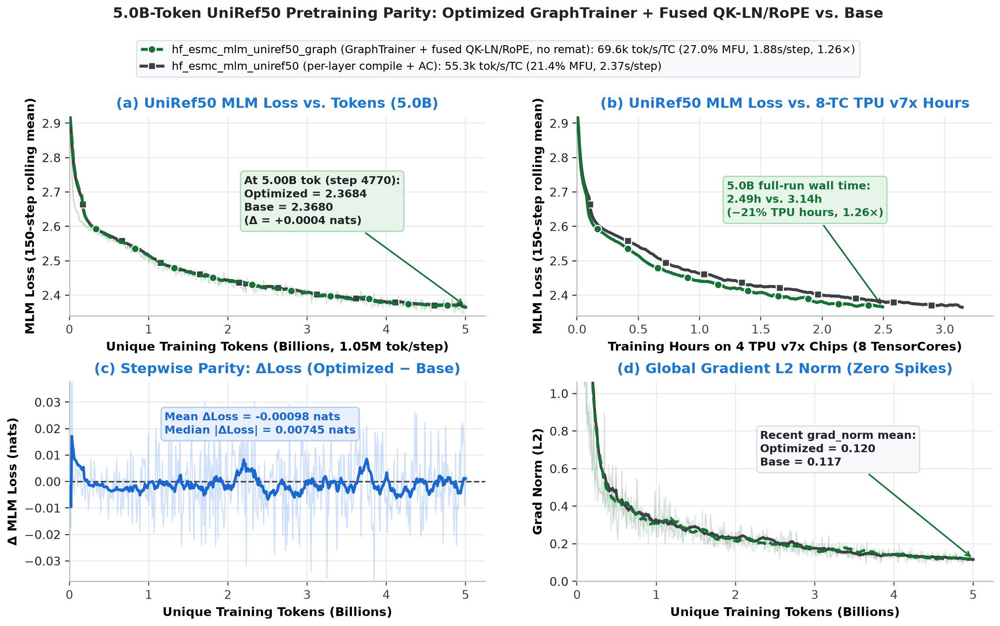

# ESM-C pretraining (`biohub/ESMC-600M`, `biohub/ESMC-6B`) on TPU Ironwood (tpu7x)

Masked-LM pretraining of the ESM Cambrian protein encoders through the TPU
HuggingFace backend (`torchtitan.experiments.tpu.transformers_modeling_backend`),
following "Language Modeling Materializes a World Model of Protein Biology":
MLM with `r_mask = 0.15`, AdamW (lr 3.1e-4, betas 0.9/0.95, eps 1e-8),
2048-token context. The paper's data mix is UniRef + MGnify + JGI; only UniRef
is redistributable, so the recipe trains on UniRef50 (see Data).

## Results

`tpu7x-16` slice (2 hosts x 4 chips, one process per TensorCore), libtpu
0.0.51, torch_tpu 0.2.1. Per-core throughput is the same on one and two hosts.
ESMC-600M rows use `--config=hf_esmc_mlm_uniref50_graph` (no rematerialization)
unless noted; ESMC-6B rows use `--config=hf_esmc_mlm_uniref50` (selective AC).

| model | config | hosts | tokens/rank | tokens/step | tok/s per TC | TFLOP/s | MFU | s/step | HBM |
|---|---|---:|---:|---:|---:|---:|---:|---:|---:|
| ESMC-600M | `hf_esmc_mlm_uniref50_graph` (no remat) | 1 | 16 x 2048 | 262k | **72,400** | 324 | **28.0%** | 0.45 | 65.4 GiB |
| ESMC-600M | `hf_esmc_mlm_uniref50_graph` (no remat, 8x accum) | 2 | 16 x 2048 | 4.19M | **69,500** | 311 | **27.0%** | 3.77 | 65.4 GiB |
| ESMC-600M | `hf_esmc_mlm_uniref50_graph` (`tpu_selective` remat) | 1 | 64 x 2048 | 1.05M | 64,800 | 290 | 25.1% | 2.02 | 40.7 GiB |
| ESMC-600M | `hf_esmc_mlm_uniref50` (layer compile, AC) | 1 | 32 x 2048 | 524k | 52,568 | 235 | 20.4% | 1.25 | 6.0 GiB |
| ESMC-600M | `hf_esmc_mlm_uniref50` (layer compile, AC) | 2 | 32 x 2048 | 4.19M | 53,318 | 238 | 20.7% | 4.92 | 6.0 GiB |
| ESMC-6B | `hf_esmc_mlm_uniref50` | 1 | 8 x 2048 | 131k | 7,850 | 339 | 29.4% | 2.09 | 3.4 GiB |
| ESMC-6B | `hf_esmc_mlm_uniref50` | 2 | 8 x 2048 | 262k | 7,922 | 342 | 29.6% | 2.07 | 3.4 GiB |
| ESMC-6B | `hf_esmc_mlm_uniref50` | 2 | 8 x 2048 | 4.19M | 8,070 | 348 | 30.2% | 32.5 | 3.4 GiB |

How the ESMC-600M number was reached, one host, ms per 2048 tokens:

| step | tok/s per TC | MFU | ms / 2048 tok |
|---|---:|---:|---:|
| 1 x 2048 tokens/rank, 1024 splash blocks (`layer` compile, AC) | 21,462 | 8.3% | 95.4 |
| 8 x 2048 tokens/rank, batch unfold, 2048 splash blocks | 47,990 | 18.6% | 42.7 |
| + ESMC attention layout (`_EsmcTPUAttention`) | 48,606 | 18.8% | 42.1 |
| + `sa_use_base2_exp`, `sa_use_experimental_scheduler`, no RNG draw at dropout 0 | 49,052 | 19.0% | 41.8 |
| + 32 x 2048 tokens/rank (`layer` compile, AC) | 52,538 | 20.4% | 39.0 |
| 16 x 2048 tokens/rank, no AC (`layer` compile, `log_freq=1`) | 54,100 | 21.0% | 37.9 |
| + `metrics.log_freq=25` (amortize scalar `.item()` host sync) | 59,600 | 23.1% | 34.4 |
| + `TpuGraphTrainer` (`aot_fx_trace`, `compile_grad_norm`, `compile_optimizer`) | 64,200 | 24.9% | 31.9 |
| + `esmc_fused_qk_norm_rope` (fused Pallas QK-LayerNorm + RoPE + heads-first) | **72,400** | **28.0%** | **28.3** |

For ESMC-6B the initial ladder is 4,810 -> 7,654 (8 x 2048, unfold) -> 7,897
(2048 splash blocks) tok/s per TC.

Convergence (MLM loss; the amino-acid unigram entropy is ~2.9 nats, below it
the model uses context):

- **ESMC-600M 5.0B-token A/B (`hf_esmc_mlm_uniref50` vs `hf_esmc_mlm_uniref50_graph`)**,
  1 host (8 TensorCores), 4,770 steps of 1,048,576 tokens (`5.00B` tokens,
  `seed=0`, `log_freq=10`, 100-step warmup + cosine decay):
  `4.4805 -> 2.5738` (0.5B) -> `2.5173` (1.0B) -> `2.4204` (2.5B) -> **`2.3684`**
  (5.0B) on `hf_esmc_mlm_uniref50_graph` (**2.49h**, 69.6k tok/s/TC, 27.0% MFU)
  vs. `4.4802 -> 2.5762 -> 2.5184 -> 2.4246 ->` **`2.3680`** on
  `hf_esmc_mlm_uniref50` (**3.14h**, 55.3k tok/s/TC, 21.4% MFU) — `+0.0004` nats
  at 5.0B (`mean Δloss = -0.00098` nats, `median |Δloss| = 0.00745` nats),
  grad-norm `0.120` vs `0.117`, zero spikes (**1.26x** faster, −20.6% TPU hours).
- **ESMC-600M 600-step A/B (`hf_esmc_mlm_uniref50` vs `hf_esmc_mlm_uniref50_graph`)**,
  1 host, 600 steps of 262k tokens (`157M` tokens, `seed=0`, 100-step warmup):
  4.25 -> 2.88 (step 20) -> 2.65 (step 100) -> 2.59 (step 300) -> **2.586**
  (steps 551-600 mean: `2.5860` baseline vs `2.5858` graph+kernels, median
  stepwise `|Δloss| = 5.5e-4`); grad-norm 26.0 -> 0.39, zero spikes.
- ESMC-600M, 1 host, 100 steps of 524k tokens, 20-step warmup:
  4.48 -> 2.97 (step 10) -> 2.89 (step 20) -> 2.71 (step 50) -> 2.63 (step 100;
  steps 81-100 mean 2.63); grad-norm 32 -> 0.4, no spikes.
- ESMC-6B, 1 host, 400 steps of 131k tokens: 4.65 -> 2.89 (step 20) -> 2.59
  (steps 351-400 mean); grad-norm 45 -> 0.8, no spikes.
- ESMC-6B, 2 hosts, 150 steps of 4.19M tokens (the paper's batch), 50-step
  warmup, cosine to 10%: 4.52 -> 2.82 (step 30) -> 2.61 (step 150); grad-norm
  46 -> 0.3, no spikes.



## What the configs do

`--config=hf_esmc_mlm_uniref50` is `hf_full_max_plain_ce` (per-layer
`torch.compile(backend="tpu")`, SimpleFSDP, `AttentionSavingSelectiveAC`,
packed-document segment masking, `mixed_precision_reduce=float32`,
`metrics.log_freq=10`) plus:

- **MLM rows** (`MLMProcessor`, `experiments/tpu/datasets.py`): BERT/ESM
  80/10/10 corruption, labels only at masked positions, no label shift. The
  default next-token processor is trivially solvable by a bidirectional
  encoder (it reads the answer from the token to its right) and must not be
  used to judge convergence.
- **Batch unfold** (`TPUHFTransformerModel.forward`): the trainer folds the
  local batch into one `[1, B*S]` stream; a FullMask encoder cannot skip
  cross-sample attention tiles, so that costs `O((B*S)^2)`. The model runs the
  stream as `[B, S]` and folds back for the head (4 x 2048 tokens/rank on 6B:
  4,374 -> 7,165 tok/s per core).
- **Row-aligned packing** (`RowAlignedPackingConfig`, `pack_rows_to_context`):
  whole proteins per 2048-token row, first-fit across the rows of a batch,
  padding at the end of each row. Plain concat-then-split lets a document
  cross a row boundary, which the unfold would attend as two halves. Costs
  1.6% of tokens as padding on UniRef50 (measured over 30 batches; plain
  concat-then-split cut a document at 31 of 32 row boundaries there).
- **ESMC attention layout** (`_EsmcTPUAttention`, `model.py`): contiguous
  `(B, H, S, D)` q/k/v in forward and backward and `rotate_half` as a `(D, D)`
  matmul, instead of strided transposes and 32-wide sub-tile slices of the
  64-wide head (+11% on 600M).
- **Splash blocks 2048 / 2048** for forward and dkv: one kv block per q block,
  so the online-softmax running max/sum/output stay in VMEM instead of being
  carried across kv grid steps, and the backward writes no partial dq per kv
  block (+3.1% on 6B). Softmax stays exact; compute sub-blocks (512 forward,
  `sa_block_kv_compute`, +2% over 1024 on 600M; 1024 dkv, since
  `kv_dkv_compute=2048` runs out of VMEM) only change the fp32 accumulation
  order.
  `sa_use_base2_exp` (hardware `exp2`) and `sa_use_experimental_scheduler`
  add +0.9% on 600M.

`--config=hf_esmc_mlm_uniref50_graph` (`metrics.log_freq=25`) runs the same
model, data, loss and SimpleFSDP on **`TpuGraphTrainer`**
(`experiments/tpu/graph_trainer/hf_transformers.py`) with two additional TPU
optimizations:

- **Joint forward + loss + backward XLA program** (`use_graph_trainer=True`,
  `compile_mode="aot_fx_trace"`, `compile_grad_norm=True`,
  `compile_optimizer=True`): keeps saved activations inside one compiled
  executable (eliminating per-layer forward/backward boundary relayout copies,
  ~6.5% of device time) with `memory_policy="default"` (zero recomputation).
- **Fused Pallas QK-LayerNorm + RoPE + heads-first kernel**
  (`esmc_fused_qk_norm_rope`, `experiments/tpu/kernels/qk_norm_rope_kernel.py` +
  `experiments/tpu/kernels/qk_norm_rope.py`): fuses `q_ln`, `k_ln`,
  `rotate_half` RoPE, `1/sqrt(64)` query scaling, and the
  `[B, S, H*D] <-> [B, H, S, D]` attention prologue/epilogue in forward and
  backward (+13% on GraphTrainer).

## Data

```bash
# ESM-C tokenizer (33 tokens; <cls> 0, <eos> 2, <mask> 32)
mkdir -p $ASSETS/esmc_tokenizer && cd $ASSETS/esmc_tokenizer
for f in tokenizer.json tokenizer_config.json special_tokens_map.json; do
  curl -sL -o $f https://huggingface.co/biohub/ESMC-6B/resolve/main/$f
done

# UniRef50 as parquet with a `text` column (the schema of the HF mirror
# `bloyal/uniref50`; `--dataloader.dataset_path` may also point at that mirror,
# or be omitted to stream it). From the UniProt FTP, first 4M clusters:
python experiments/tpu/recipes/ironwood/esmc/fasta_to_parquet.py $DATA/uniref50 4000000
```

## Training

One host (8 TensorCores), ESMC-600M on `TpuGraphTrainer` + fused kernels (`32768`
tokens/rank = `16 x 2048`, 65.4 GiB HBM; for ESMC-6B use
`--config=hf_esmc_mlm_uniref50` and drop `num_tokens_per_microbatch_per_dp_rank`):

```bash
TORCH_TPU_TIER2_COMPILATION_CACHE=$USER \
torchrun --nproc_per_node=8 -m torchtitan.experiments.tpu.train \
  --module=torchtitan.experiments.tpu.transformers_modeling_backend \
  --config=hf_esmc_mlm_uniref50_graph \
  --hf_model=biohub/ESMC-600M \
  --hf_assets_path=$ASSETS/esmc_tokenizer \
  --dataloader.dataset_path=$DATA/uniref50 \
  --training.num_tokens_per_microbatch_per_dp_rank=32768 \
  --training.steps=600 \
  --checkpoint.no-enable
```

Full `tpu7x-16` slice (2 hosts x 8 TensorCores) at the paper's 4,194,304-token
optimizer step without rematerialization (`16 x 2048` tokens/rank x 8
microbatches, `--config=hf_esmc600m_mlm_uniref50_tpu7x16`). Run on **each** host
with its own `NODE_RANK` (0 on worker 0, 1 on worker 1):

```bash
export TPU_WORKER_HOSTNAMES=<worker0-ip>,<worker1-ip>
export TPU_CHIPS_PER_HOST_BOUNDS=2,2,1 TPU_HOST_BOUNDS=1,1,2 TPU_ACCELERATOR_TYPE=tpu7x-16
TORCH_TPU_TIER2_COMPILATION_CACHE=$USER \
torchrun --nnodes=2 --nproc_per_node=8 --rdzv_backend=static \
  --rdzv_endpoint=<worker0-ip>:29501 --node_rank=$NODE_RANK \
  -m torchtitan.experiments.tpu.train \
  --module=torchtitan.experiments.tpu.transformers_modeling_backend \
  --config=hf_esmc600m_mlm_uniref50_tpu7x16 \
  --hf_assets_path=$ASSETS/esmc_tokenizer \
  --dataloader.dataset_path=$DATA/uniref50 \
  --training.steps=150 \
  --checkpoint.no-enable
```

For GKE / Cluster Toolkit (`gcluster`) deployment on a 2-host `tpu7x-16`
(`2x2x2`) cluster, see [tpu7x-2x2x2/README.md](tpu7x-2x2x2/README.md).
