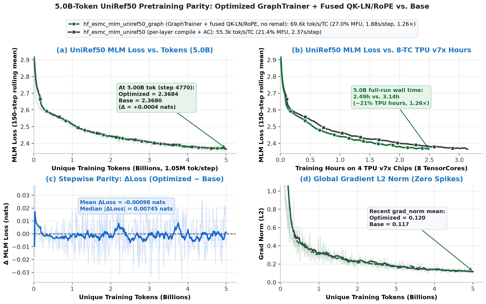

# Recipe for training ESMC-600M on a 16-device (8-chip) TPU Ironwood cluster (`tpu7x-2x2x2`)

Masked-LM pretraining of `biohub/ESMC-600M` on UniRef50 at the paper's optimizer
step of 4,194,304 tokens (2,048 sequences x 2,048 tokens), using
`--config=hf_esmc600m_mlm_uniref50_tpu7x16` (`TpuGraphTrainer` + fused Pallas
kernels, no activation rematerialization). Data preparation, the tokenizer, and
the ablation ladder are documented in the ESM-C [README.md](../README.md);
cluster setup and Docker image instructions are in the main
[README.md](../../../../README.md).

After setting up your cluster, export:

```bash
export PROJECT_ID=YOUR_PROJECT_ID
export ZONE=YOUR_ZONE
export CLUSTER_NAME=YOUR_CLUSTER_NAME
export WORKLOAD_IMAGE=YOUR_TORCHTITAN_IMAGE
export ASSETS=PATH_TO_ASSETS   # holds esmc_tokenizer/, see ../README.md
export DATA=PATH_TO_DATA       # holds uniref50/ parquet, see ../README.md
```

## Notes

- **Devices vs chips**: an Ironwood chip exposes two TensorCores, and TorchTitan
  runs one process per core. `tpu7x-16` (`2x2x2`) is 16 devices across 8 chips,
  run as 2 hosts x 8 processes. Throughput and MFU below are per device (per
  TensorCore) against the per-core bf16 peak of 1,153.5 TFLOP/s.
- **No rematerialization (`memory_policy="default"`)**: 16 sequences of 2,048
  tokens per device per microbatch (32,768 tokens, 65.4 GiB HBM) is the largest
  power-of-two divisor of 64 sequences that fits 96 GiB without activation
  rematerialization (32 sequences exceeds 96 GiB; 1-microbatch 64 x 2,048 with
  `tpu_selective` remat runs at 25.1% MFU). 16 devices x 8 microbatches x 32,768
  tokens = 4,194,304 tokens per optimizer step.

## Training Configuration Details

[`hf_esmc600m_mlm_uniref50_tpu7x16`](../../../../transformers_modeling_backend/config_registry.py)
builds on `hf_esmc_mlm_uniref50_graph` with:
- **Model**: `biohub/ESMC-600M` (36 layers, hidden 1152, 18 heads of 64, SwiGLU 3072).
- **Microbatch**: `training.num_tokens_per_microbatch_per_dp_rank = 16 * 2048` (32,768).
- **Optimizer step**: `training.num_tokens_per_train_step = 32 * 64 * 2048` (4,194,304).
- **Logging**: `metrics.log_freq = 10`.

Inherited from `hf_esmc_mlm_uniref50_graph`: 2,048-token context with row-aligned
protein packing, MLM with `r_mask = 0.15`, AdamW (`lr=3.1e-4`, `betas=(0.9, 0.95)`),
100-step warmup then cosine decay to 10%, `TpuGraphTrainer` (`aot_fx_trace`,
joint forward+loss+backward XLA program with `memory_policy="default"`,
`compile_grad_norm`, `compile_optimizer`), SimpleFSDP, fused Pallas
QK-LayerNorm + RoPE + heads-first kernel (`esmc_fused_qk_norm_rope`), and Splash
Attention with 2,048 blocks.

## Training Command

```bash
export WORKLOAD_NAME="esmc-600m-tpu7x16-$(date +%H%M%S)"

gcluster job submit \
  --name "$WORKLOAD_NAME" \
  --cluster "$CLUSTER_NAME" \
  --compute-type tpu7x \
  --topology 2x2x2 \
  --num-slices 1 \
  --project "$PROJECT_ID" \
  --location "$ZONE" \
  --gke-disable-parallel-containers \
  --image "$WORKLOAD_IMAGE" \
  --env="PYTHONUNBUFFERED=1" \
  --env="WORKERS_0_HOSTNAME=${WORKLOAD_NAME}-main-job-0-0.${WORKLOAD_NAME}" \
  --env="WORKLOAD_NAME=$WORKLOAD_NAME" \
  --env="TORCH_TPU_TIER2_COMPILATION_CACHE=esmc" \
  --command "torchrun \
    --nnodes=2 \
    --nproc_per_node=8 \
    --rdzv_backend=static \
    --rdzv_endpoint=\$WORKERS_0_HOSTNAME:29501 \
    --node_rank=\$TPU_WORKER_ID \
    -m torchtitan.experiments.tpu.train \
    --module=torchtitan.experiments.tpu.transformers_modeling_backend \
    --config=hf_esmc600m_mlm_uniref50_tpu7x16 \
    --hf_assets_path=$ASSETS/esmc_tokenizer \
    --dataloader.dataset_path=$DATA/uniref50 \
    --training.steps=400 \
    --checkpoint.no-enable"
```

On TPU VMs instead of GKE, run the same `torchrun` on each of the 2 hosts with
its own `--node_rank` after exporting the slice geometry as in
[../README.md](../README.md) (`TPU_HOST_BOUNDS=1,1,2`, `TPU_ACCELERATOR_TYPE=tpu7x-16`).

## Measured Metrics

Measured on a `tpu7x-16` slice (`2x2x2`, 16 devices across 2 hosts), libtpu
0.0.51, torch_tpu 0.2.1:

| config | devices | microbatches / step | tokens / step | TPS/device | TFLOP/s/device | MFU | s/step | HBM |
|---|---:|---:|---:|---:|---:|---:|---:|---:|
| `hf_esmc600m_mlm_uniref50_tpu7x16` (no remat) | 16 | 8 | 4.19M | **69,500** | 311 | **27.0%** | 3.77 | 65.4 GiB |
| `hf_esmc_mlm_uniref50_graph` (1-microbatch, no remat) | 16 | 1 | 524k | **72,400** | 324 | **28.0%** | 0.45 | 65.4 GiB |
| `hf_esmc_mlm_uniref50` (per-layer compile + AC) | 16 | 4 | 4.19M | 53,318 | 238 | 20.7% | 4.92 | 6.0 GiB |

Total cluster throughput at the 4.19M-token step on `tpu7x-16`: **1.11M tokens/s**
(up from 0.85M tokens/s / 20.7% MFU with per-layer `torch.compile` + activation
checkpointing, and up from 0.90M tokens/s / 21.9% MFU for per-layer
`torch.compile` without rematerialization).

## Convergence Parity (5.0B UniRef50 Tokens)

Head-to-head UniRef50 MLM pretraining over 4,770 steps of 1,048,576 tokens
(`5.00B` tokens, `seed=0`, `log_freq=10`, 100-step warmup + cosine decay) shows
identical MLM loss and gradient-norm trajectories (`2.3684` vs `2.3680` at 5.0B,
`mean Δloss = -0.00098` nats, zero gradient spikes) while cutting 8-TC wall time
from **3.14h to 2.49h (1.26x, −20.6%)**:


